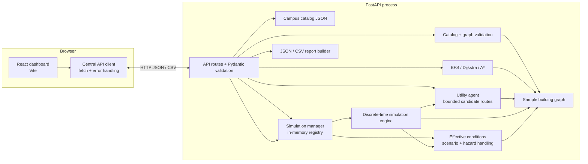

# SafeRoute architecture

## Component responsibilities

- **React + Vite frontend (`frontend/src/`)** renders the schematic map, route planner, comparison cards, simulation controls, hazard/scenario panels, analytics, event timeline, and report-download actions. `src/services/api.js` centralizes HTTP requests, base URL selection, API error conversion, and blob downloads.
- **FastAPI app (`backend/app/main.py`, `api/routes.py`)** exposes health/building, route, utility, comparison, scenario, simulation, hazard, condition, event, and report operations. Pydantic request models validate supported options before service calls.
- **Campus catalog, building loader, and graph algorithms (`data/campus_catalog.json`, `services/building.py`, `algorithms/`)** expose sourced reference names, select an explicitly illustrative graph model, validate graph IDs/types/floors/edge values, filter hard exclusions into an adjacency list, run BFS/Dijkstra/A*, reconstruct routes, and calculate route metrics.
- **Utility agent (`agents/`)** creates a bounded set of simple candidate paths and scores them using time, estimated risk, crowding, and accessibility preferences. It is used by the standalone utility API and by the simulation engine for route assignment/replanning.
- **Simulation engine and manager (`simulation/engine.py`, `service.py`, `models.py`)** bind each process-local run to its selected building ID, graph copy, and engine. The manager scopes movement, effective conditions, hazards, exits, analytics, and report graph data to that run.
- **Hazard and scenario management (`simulation/service.py`, `scenarios.py`)** maintains run state, preset creation/reset, hazard activation/resolution, manual exit status, effective restrictions, and condition-triggered replanning. Conditions are derived without mutating the original building data.
- **Reporting (`simulation/reports.py`)** serializes one selected in-memory run as JSON or CSV. It does not aggregate/persist historic runs.

## Request and reporting flow

1. The dashboard loads `GET /api/campus`, the selected building graph, and scenarios through the API wrapper; the current simulation ID is stored in browser session storage for a reload recovery attempt.
2. A route request reaches a FastAPI route and then the graph algorithm module. A comparison uses the same graph and restrictions for BFS, Dijkstra, A*, and Utility AI.
3. Simulation creation resolves an optional `building_id` through the validated catalog (or uses the backward-compatible default), then retains a separate graph and engine for the run. Simulation controls reach the `SimulationManager` by run ID. Active hazards/exits update that run's effective hard restrictions and may trigger utility-agent replanning.
4. The backend returns serialized route/simulation state. The UI highlights returned node/corridor IDs and displays backend metrics and events.
5. A report request serializes the requested run's current analytics, settings, people, hazards, events, and corridor occupancy as a download.

## Architecture diagram

## State and trust boundaries

Building data is a checked-in JSON fixture. Simulation runs, hazards, event history, and report inputs live in memory in the backend process. The browser stores only the active run ID, not authoritative simulation state. A backend restart clears the run and causes a later fetch to return not found. Frontend values are presentation; route decisions and simulation outcomes are returned by the backend.

## Current architectural limits

The system has no database, authentication, sensor integration, persistent multi-building storage, deployment configuration, or real-time push transport. Simulation updates use browser polling. Route comparison with a simulation uses its bound graph; an explicitly supplied conflicting model ID is rejected. Presets that reference graph-specific IDs fail validation when run against an incompatible model. The graph, estimated travel times, occupancy/capacity values, crowd behavior, and hazard propagation are illustrative. SafeRoute is a university academic prototype, not a certified emergency-response system.
